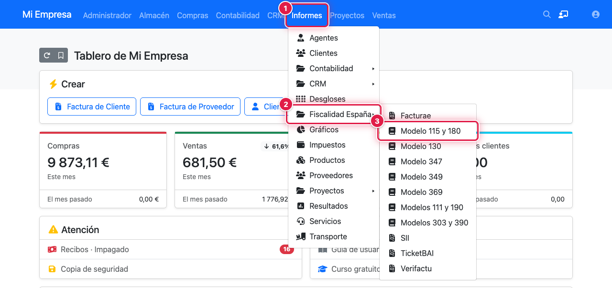
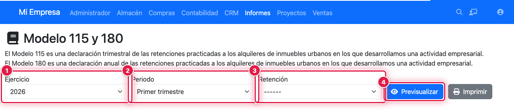
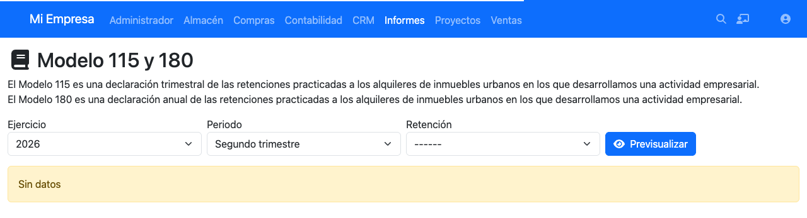
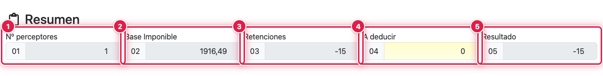
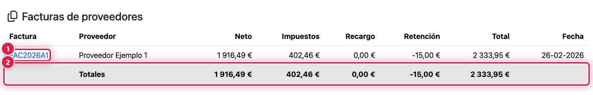
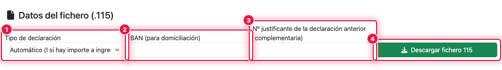
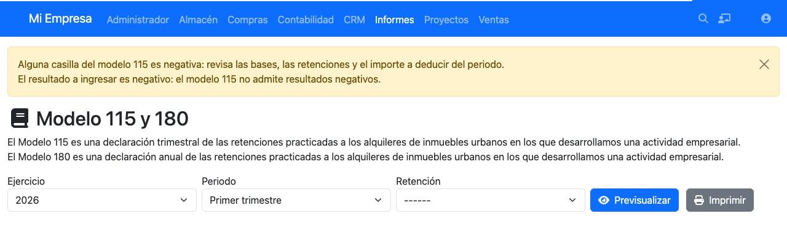

El Modelo 115 es la declaración trimestral de las retenciones que practicas al pagar el alquiler de inmuebles urbanos en los que desarrollas una actividad empresarial. El programa lo calcula a partir de tus facturas de proveedor con retención de IRPF, rellena las casillas, imprime el resumen y genera el fichero para presentarlo en la AEAT.

## 👥 ¿Quién tiene que presentarlo?

Tienes que presentarlo cada trimestre si pagas alquileres de oficinas, locales u otros inmuebles urbanos a un arrendador y le retienes IRPF en la factura. El resumen del año de esas mismas retenciones es el Modelo 180, que se explica en [Cómo hacer el Modelo 180](como-hacer-el-modelo-180.md).

## ⚙️ Antes de empezar

Las retenciones salen de las **facturas de proveedor** con IRPF distinto de cero, así que las facturas de alquiler tienen que estar ya registradas en el trimestre, con la retención aplicada.

Si en la contabilidad del ejercicio hay subcuentas de retenciones de alquileres, el programa solo cuenta las facturas cuyo asiento usa alguna de ellas, para dejar fuera las retenciones de profesionales, que van al Modelo 111. Para marcar esas subcuentas, asigna la cuenta especial **IRPFA** a la subcuenta de retenciones de alquileres o a su cuenta. Si el ejercicio no tiene ninguna subcuenta con **IRPFA**, el programa no puede distinguirlas y cuenta todas las facturas con retención. Una factura sin asiento también se cuenta.

Si no ves el menú del paso 3 de la sección siguiente, activa el plugin Modelo115 desde **menú Administrador** → **Plugins**.

## 📋 Cómo se rellena

1. Pulsa el menú **Informes**.
2. Pasa el ratón por **Fiscalidad España**.
3. Elige **Modelo 115 y 180**.

Ahora elige qué declaración quieres ver. Al abrir la pantalla aparecen el ejercicio del año en curso y el trimestre en curso.

1. Elige el **Ejercicio**. La lista agrupa los ejercicios por empresa.
2. Elige el **Periodo**: **Primer trimestre**, **Segundo trimestre**, **Tercer trimestre** o **Cuarto trimestre**. La opción **Anual (Modelo 180)** es para el resumen anual.
3. Si quieres ver solo un tipo de retención, elige una **Retención**, por ejemplo **IRPF 19% alquileres**. El programa deja solo las facturas con ese porcentaje de IRPF. Con ------ salen todas.
4. Pulsa **Previsualizar**.

Si el periodo no tiene facturas con retención, la pantalla muestra el aviso **Sin datos**.

### Las casillas

El **Resumen** repite las casillas del modelo oficial: el **Nº perceptores** (1), con las personas distintas a las que has pagado; la **Base imponible** (2), que es el neto de las facturas; las **Retenciones** (3), que es el IRPF de las facturas; **A deducir** (4) y el **Resultado** (5), que es el importe a ingresar.

La casilla **A deducir** es la única que puedes escribir. Déjala en 0 salvo que ya hayas ingresado algo de este trimestre en otra autoliquidación. Escribe el importe y sal del campo: el programa recalcula el **Resultado**, que es las **Retenciones** menos lo que hay en **A deducir**.

### Las facturas

Debajo están las **Facturas de proveedores** que forman el modelo, con su neto, impuestos, recargo, retención, total y fecha. Pulsa el código de una factura (1) para abrirla. La última fila, **Totales** (2), suma cada columna.

## 🖨️ Imprimir el resumen

Cuando el periodo tiene facturas, junto a **Previsualizar** aparece el botón **Imprimir**. Abre en otra pestaña un PDF con el resumen de las casillas y la lista de facturas con sus totales. Si el periodo es el anual, añade también la tabla de perceptores del Modelo 180.

## 📤 Descargar el fichero para la AEAT

Solo los trimestres tienen fichero. En la sección **Datos del fichero (.115)**, antes de descargar:

1. **Tipo de declaración**: por defecto es **Automático (I si hay importe a ingresar, N si no)**. También puedes elegir **I - Ingreso**, **U - Domiciliación**, **G - Ingreso a anotar en la cuenta corriente tributaria** o **N - Negativa**.
2. **IBAN (para domiciliación)**: es obligatorio solo con el tipo **U - Domiciliación**.
3. **Nº justificante de la declaración anterior (complementaria)**: son 13 cifras y es obligatorio si hay algo en la casilla **A deducir**, porque entonces la declaración es complementaria.
4. Pulsa **Descargar fichero 115**.

El fichero se llama `NIF_año_periodo.115`, por ejemplo `NIF_2026_1T.115`. Súbelo en la presentación del Modelo 115 por fichero de la sede electrónica de la AEAT.

### Si no se genera el fichero

El programa no genera el fichero y muestra un aviso cuando falta algo o no cuadra. Corrígelo y vuelve a pulsar **Descargar fichero 115**:

- **El NIF de la empresa (...) no es válido para el fichero del modelo 115.** Corrígelo en los datos de la empresa.
- **Alguna casilla del modelo 115 es negativa: revisa las bases, las retenciones y el importe a deducir del periodo.** Pasa, por ejemplo, cuando una factura rectificativa deja el periodo en negativo.
- **El resultado a ingresar es negativo: el modelo 115 no admite resultados negativos.**
- **Para domiciliar el pago (tipo U) hay que indicar el IBAN.**
- **Una declaración negativa (tipo N) no puede tener importe a ingresar.**
- **Hay importes a deducir de autoliquidaciones anteriores: es una complementaria y hay que indicar el nº de justificante (13 cifras) de la declaración anterior.**

## 🔧 Si algo no coincide

- Cambia los datos desde las facturas de proveedor y pulsa **Previsualizar** de nuevo: el cálculo se rehace cada vez.
- Si falta una factura, comprueba que su fecha está dentro del trimestre, que tiene retención de IRPF y que, si el ejercicio usa la cuenta especial **IRPFA**, su asiento usa una subcuenta de retenciones de alquileres.
- Si sobra una factura de un profesional, revisa que su retención no esté en una subcuenta con la cuenta especial **IRPFA**.

## Ver también

- [Cómo hacer el Modelo 180](como-hacer-el-modelo-180.md)
- [Inmuebles del Modelo 180](inmuebles-del-modelo-180.md)
