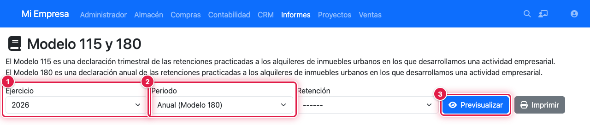
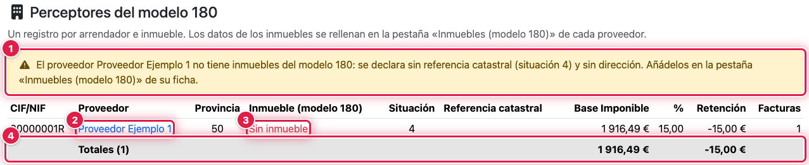
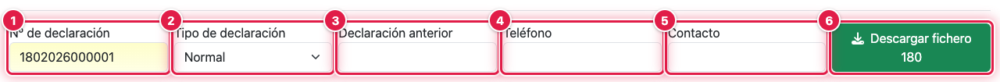
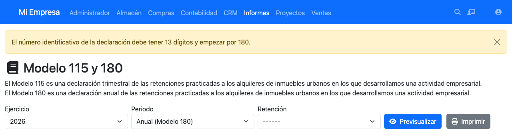

El Modelo 180 es el resumen anual de las retenciones que has practicado en los alquileres de inmuebles urbanos en los que desarrollas una actividad empresarial. Es el mismo cálculo del Modelo 115 de todo el año, pero declarado por arrendador y por inmueble. El programa agrupa tus facturas de proveedor con retención, avisa de los datos que faltan y genera el fichero para presentarlo en la AEAT.

## 👥 ¿Quién tiene que presentarlo?

Tienes que presentarlo una vez al año si has pagado alquileres de inmuebles urbanos y has retenido IRPF. Cada arrendador, y cada uno de sus inmuebles, es un registro del fichero.

## ⚙️ Antes de empezar

- Las facturas de alquiler tienen que estar registradas en el año con la retención aplicada, igual que para el Modelo 115 (consulta [Cómo hacer el Modelo 115](como-hacer-el-modelo-115.md)).
- Cada arrendador tiene que ser un **proveedor** con NIF y con un código postal o una provincia en su dirección, para que el programa saque su provincia.
- Los inmuebles se dan de alta en la pestaña **Inmuebles (modelo 180)** de la ficha del proveedor. Cómo se rellenan está en [Inmuebles del Modelo 180](inmuebles-del-modelo-180.md).

## 📋 Cómo se rellena

Entra en **menú Informes** → **Fiscalidad España** → **Modelo 115 y 180** y:

1. Elige el **Ejercicio**.
2. Elige el **Periodo** **Anual (Modelo 180)**.
3. Pulsa **Previsualizar**.

El **Resumen** suma los perceptores, la base y las retenciones de todo el año, con las mismas casillas que el Modelo 115. Debajo aparece la sección **Perceptores del modelo 180**.

### Un registro por arrendador e inmueble

La tabla tiene una fila por cada arrendador y cada inmueble, con su CIF/NIF, la **Provincia**, el inmueble, la **Situación** (un valor del 1 al 4, según tenga o no referencia catastral y dónde), la **Referencia catastral**, la **Base Imponible**, el porcentaje de retención, la **Retención** y el número de **Facturas**. Si dejas el ratón sobre ese número, ves los códigos de las facturas. Encima de la tabla puede salir un aviso (1), como el de un proveedor sin inmuebles.

- Pulsa el nombre del proveedor (2) para abrir su ficha en la pestaña **Inmuebles (modelo 180)**.
- Pulsa el nombre de un inmueble para abrir su ficha.
- **Sin inmueble** (3) en rojo indica que el proveedor no tiene inmuebles dados de alta: se declara sin referencia catastral, con la situación 4 y sin dirección.
- La etiqueta **Reparto** indica que parte de la base del inmueble sale del reparto de facturas que no indican su inmueble.
- La fila **Totales** (4) suma la base y las retenciones y cuenta los registros.

Los avisos de datos obligatorios (un proveedor sin NIF, sin provincia o sin domicilio en España, y un inmueble al que le faltan datos) impiden descargar el fichero hasta que los corrijas, porque la AEAT lo rechazaría. Los demás solo informan.

### A qué inmueble va cada factura

- Si la factura indica su inmueble, va a ese.
- Si no lo indica y el proveedor tiene un solo inmueble, va a él.
- Si el proveedor tiene varios inmuebles, el programa reparte la base y la retención entre ellos según su **Porcentaje de reparto** o, si ninguno lo tiene, a partes iguales. Indica el inmueble en cada factura para que el reparto sea exacto.
- Si el proveedor no tiene inmuebles, la factura va a **Sin inmueble**.

## ⚠️ Avisos

Los avisos salen encima de la tabla, uno por cada problema. Donde aquí pone `nombre`, `inmueble`, `campos`, `n` o `código`, el programa muestra el dato real. Los cuatro primeros impiden descargar el fichero:

- **El proveedor `nombre` no tiene NIF.** Añade el NIF en la ficha del proveedor.
- **No se ha podido sacar la provincia del proveedor `nombre`: revisa el código postal de su dirección.** Corrige el código postal o la provincia de su dirección.
- **El proveedor `nombre` no tiene domicilio en España: el modelo 180 solo admite NIF españoles (los no residentes van a los modelos 216 y 296).**
- **Al inmueble `inmueble` del proveedor `nombre` le faltan datos: `campos`.** Los campos que se comprueban son **Referencia catastral** (salvo en la situación 4), **Nombre de la vía**, **Municipio**, **Provincia** y **Código Postal**.
- **El proveedor `nombre` no tiene inmuebles del modelo 180: se declara sin referencia catastral (situación 4) y sin dirección. Añádelos en la pestaña «Inmuebles (modelo 180)» de su ficha.**
- **Las facturas sin inmueble del proveedor `nombre` se han repartido entre sus `n` inmuebles según su porcentaje (a partes iguales si no tienen). Indica el inmueble en cada factura para que el reparto sea exacto.**
- **La factura `código` tiene un inmueble que no es de su proveedor: se ha tratado como si no tuviera inmueble.**
- **La base del perceptor `nombre` es negativa: revisa sus facturas rectificativas.**

## 📤 Descargar el fichero para la AEAT

Debajo de la tabla están los datos de la declaración:

1. **Nº de declaración**: son 13 cifras que empiezan por 180. El programa propone 180, el año y 000001.
2. **Tipo de declaración**: **Normal**, **Complementaria** o **Sustitutiva**.
3. **Declaración anterior**: el número de la declaración que se complementa o se sustituye. Es obligatorio en la complementaria y la sustitutiva, con 13 cifras que empiezan por 180.
4. **Teléfono**: el de contacto. El programa propone el de la empresa.
5. **Contacto**: la persona con quien relacionarse, con el primer apellido, el segundo y el nombre. El programa propone el administrador de la empresa.
6. Pulsa **Descargar fichero 180**.

El fichero se llama `modelo180_año.txt`, por ejemplo `modelo180_2026.txt`. Súbelo en la presentación del Modelo 180 por fichero de la sede electrónica de la AEAT.

### Si no se genera el fichero

Si hay avisos de datos obligatorios (ver [Avisos](#avisos)), el programa los repite y muestra **Corrige los datos de los perceptores e inmuebles anteriores para descargar el fichero del modelo 180.** Corrígelos y vuelve a descargarlo.

Si el número de declaración no tiene 13 cifras que empiecen por 180, el programa no descarga nada y muestra **El número identificativo de la declaración debe tener 13 dígitos y empezar por 180.** Si la declaración es complementaria o sustitutiva y la anterior no es válida, el aviso es **En una declaración complementaria o sustitutiva hay que indicar el número identificativo de la declaración anterior: 13 dígitos que empiezan por 180.**

## 🖨️ Imprimir

El botón **Imprimir** abre en otra pestaña un PDF con el resumen, la tabla de perceptores por arrendador e inmueble y las facturas del año.

## Ver también

- [Inmuebles del Modelo 180](inmuebles-del-modelo-180.md)
- [Cómo hacer el Modelo 115](como-hacer-el-modelo-115.md)
