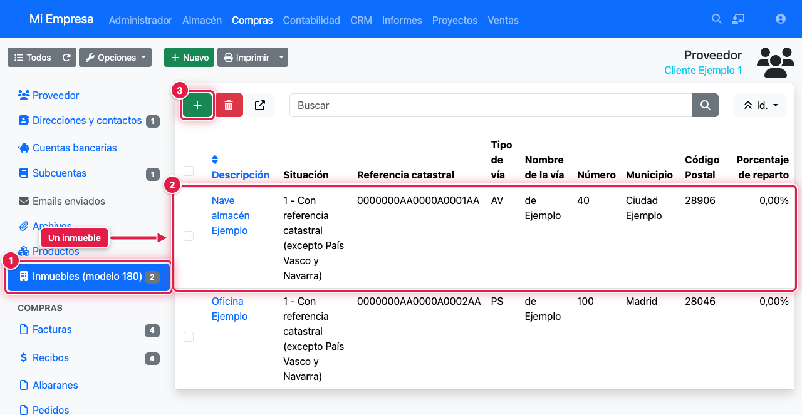
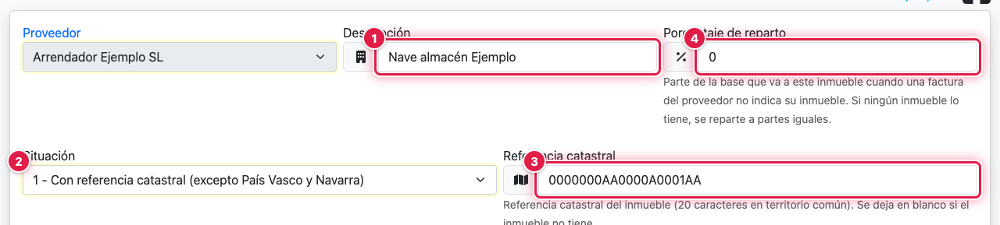
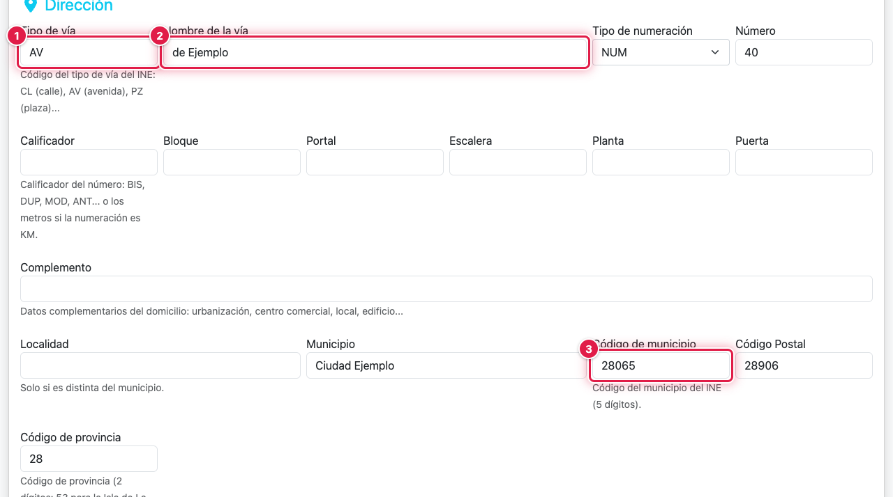
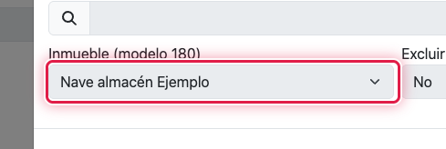

El Modelo 180 declara cada arrendador con los datos del inmueble que alquilas: situación, referencia catastral y dirección. Esos datos se guardan en la ficha del proveedor, en la pestaña **Inmuebles (modelo 180)**, y las facturas de compra pueden indicar a qué inmueble corresponden. Si no lo indican, el programa decide solo a qué inmueble va cada factura.

## ⚙️ Antes de empezar

- El proveedor (el arrendador) tiene que existir, con su NIF y el código postal de su dirección.
- Si un proveedor no tiene inmuebles, el Modelo 180 lo declara sin referencia catastral (situación 4) y sin dirección, y avisa de ello.

## 🏢 Añadir un inmueble al proveedor

1. Ve al **menú Compras** → **Proveedores** y abre el proveedor.
2. Pulsa la pestaña **Inmuebles (modelo 180)** (1). El número que lleva es la cantidad de inmuebles que ya tiene.
3. Para modificar un inmueble, pulsa su descripción en el listado (2). Para crear uno nuevo, pulsa el botón verde **+** (3).

Rellena el formulario del inmueble y pulsa **Guardar**.

### Datos generales

Rellena, por este orden:

1. **Descripción**: un nombre para reconocer el inmueble («Local de la calle Mayor»). Es el texto que verás al elegirlo en las facturas.
2. **Situación**: elige una de las cuatro opciones: **1 - Con referencia catastral (excepto País Vasco y Navarra)**, **2 - Con referencia catastral en el País Vasco**, **3 - Con referencia catastral en Navarra** o **4 - Sin referencia catastral**.
3. **Referencia catastral**: en la situación 1 tiene que tener 20 caracteres; en las situaciones 2 y 3 es obligatoria. En la situación 4 se deja en blanco: si escribes una, el programa la borra al guardar.
4. **Porcentaje de reparto**: la parte de la base que va a este inmueble cuando una factura del proveedor no indica su inmueble. Va de 0 a 100 (más abajo se explica cómo se usa).

### Dirección normalizada

El grupo **Dirección** pide la dirección tal como la quiere el registro del Modelo 180:

- **Tipo de vía** (1): el código del INE de la vía, como `CL` (calle), `AV` (avenida) o `PZ` (plaza). El campo ofrece una lista con los más habituales.
- **Nombre de la vía** (2), sin el tipo de vía.
- **Tipo de numeración** y **Número**: **NUM** para un número de calle, **KM.** para un punto kilométrico o **S/N** si no tiene número.
- **Calificador**, **Bloque**, **Portal**, **Escalera**, **Planta** y **Puerta**, solo si el inmueble los tiene. El calificador es el complemento del número: BIS, DUP, MOD, ANT...
- **Complemento**: urbanización, centro comercial, local o edificio.
- **Localidad**, solo si es distinta del municipio, y **Municipio**.
- **Código de municipio** (3): el código del INE de 5 dígitos.
- **Código Postal**, de 5 dígitos.
- **Código de provincia**: 2 dígitos (53 para la Isla de La Palma). Si lo dejas vacío, el programa lo calcula con el código postal.

⚠️ El programa no deja guardar un inmueble con datos incorrectos: situación distinta de 1 a 4, referencia catastral que falta (o que no tiene 20 caracteres en la situación 1), porcentaje fuera de 0 a 100, código postal o de municipio que no tengan 5 dígitos o provincia que no exista.

Para que el inmueble se pueda declarar hacen falta además la referencia catastral (salvo en la situación 4), el nombre de la vía, el municipio, la provincia y el código postal. Si falta alguno, el Modelo 180 avisa con el nombre del inmueble y los datos que faltan.

## 🧾 Elegir el inmueble en una compra

El selector aparece en los presupuestos, pedidos, albaranes y facturas de proveedor, siempre que el proveedor tenga algún inmueble.

1. Abre el documento de compra y pulsa **Detalle**, en la cabecera.
2. Busca el campo **Inmueble (modelo 180)** y elige el inmueble. Cada opción muestra su descripción o, si no tiene, su dirección.
3. Pulsa **Aceptar** y guarda el documento.

Por defecto el campo está en **Automático**. Si cambias el proveedor del documento y el inmueble elegido era de otro, el programa lo quita. En un documento que ya no se puede editar, como una factura cerrada, el campo está desactivado.

## 🤖 Qué hace el programa en automático

Cuando calcula el Modelo 180, el programa reparte cada factura así:

- **La factura indica su inmueble**: toda su base y su retención van a ese inmueble.
- **El proveedor tiene un solo inmueble**: todas sus facturas van a él, aunque no lo indiquen.
- **El proveedor tiene varios y la factura no indica ninguno**: la base y la retención se reparten entre sus inmuebles según el **Porcentaje de reparto** de cada uno. Si ninguno tiene porcentaje, se reparten a partes iguales. Esos registros llevan la etiqueta **Reparto** y el modelo avisa de ello. Para que el reparto sea exacto, indica el inmueble en cada factura.
- **El proveedor no tiene inmuebles**: se declara un registro sin referencia catastral (situación 4) y sin dirección, y el modelo lo avisa.
- **La factura indica un inmueble que es de otro proveedor**: se trata como si no indicara ninguno y el modelo avisa del código de la factura.

El resultado es un registro por arrendador e inmueble.

## Ver también

- [Cómo hacer el Modelo 180](como-hacer-el-modelo-180.md)
- [Cómo hacer el Modelo 115](como-hacer-el-modelo-115.md)
